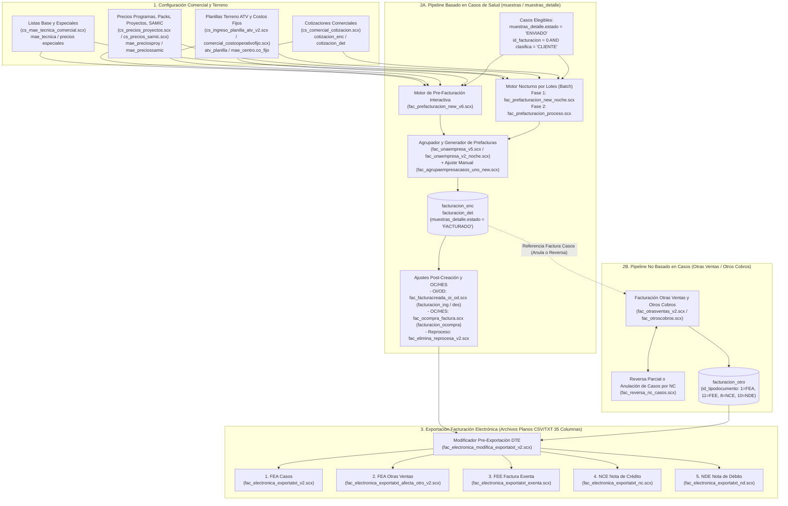

# Ingeniería Inversa: Ecosistema de Facturación, Valorización y Comercial — Área de Salud (`LaboratorioADL`)

Este documento detalla la arquitectura completa de **Valorización, Pre-facturación, Facturación, Cobros Especiales y Facturación Electrónica (DTE)** del **Área de Salud** en `LaboratorioADL` (excluyendo Medio Ambiente), extraída directamente del código fuente de los formularios Visual FoxPro (`FORMS\fac_*.scx`, `FORMS\cs_precios*.scx`, `FORMS\cs_comercial_*.scx`, `FORMS\comercial_*.scx` y `FORMS\cs_ingreso_planilla_atv*.scx`).

---

## 1. Mapa Arquitectónico General de Facturación en Salud

En `LaboratorioADL`, la facturación del Área de Salud **no se limita a cobrar análisis de casos clínicos**. El sistema opera sobre **dos grandes tuberías transaccionales** (`Pipeline A: Basada en Casos` y `Pipeline B: No Basada en Casos / Otras Ventas y Otros Cobros`), complementadas por **recargos operacionales de terreno**, **ajustes post-prefactura (`OI`/`OD`)**, **cotizaciones** y **5 motores de exportación de Documentos Tributarios Electrónicos (DTE)**.



### Resumen de todos los Tipos de Facturación existentes en el Área de Salud

| Categoría | Modalidad de Facturación | Formulario Principal | Tablas Destino |
| :--- | :--- | :--- | :--- |
| **1. Casos Estándar y Programas** | Valorización por técnica según programa sanitario (`PVA`, `Screening`, `CISA/PVS/SRS`, `SDiag-ATV`, `I+D`, `Inv. Lab`, `SAMIC`, `Caligus`) | [fac_prefacturacion_new_v6.scx](file:///c:/Users/frehbein/Desktop/ingeneiria%20inversa/LaboratorioADL/FORMS/fac_prefacturacion_new_v6.scx) | `muestras`, `muestras_detalle`, `facturacion_enc`, `facturacion_det` |
| **2. Modalidades Tarifarias Especiales en Casos** | **Packs**, **Proyectos**, **ATBPlex por Rango de Muestras**, **Ensilaje** (Normativo / Derivación / No Normativo), **PROA**, **Screening Multiplex / Apertura**, **Derivaciones** | [fac_prefacturacion_new_v6.scx](file:///c:/Users/frehbein/Desktop/ingeneiria%20inversa/LaboratorioADL/FORMS/fac_prefacturacion_new_v6.scx) | `muestras_detalle` (`vtaunitario`, `vtatotal`, `n_analisis`) |
| **3. Cobros Operacionales de Terreno (Inyectados en Casos)** | **Costo Operativo Visita ATV** (`id_tecnica = 282`), **Costo Fijo por Centro MOWI**, **Costo Screening por Crotales**, **Jornada de Muestreo AquaGen** (`id_tecnica = 955`) | [cs_ingreso_planilla_atv_v2.scx](file:///c:/Users/frehbein/Desktop/ingeneiria%20inversa/LaboratorioADL/FORMS/cs_ingreso_planilla_atv_v2.scx), [comercial_costooperativofijo.scx](file:///c:/Users/frehbein/Desktop/ingeneiria%20inversa/LaboratorioADL/FORMS/comercial_costooperativofijo.scx) | `atv_planilla`, `mae_centro`, `muestras_detalle` |
| **4. Ajustes Financieros sobre Facturas de Casos** | **Otros Ingresos (`OI`)** y **Otros Descuentos (`OD`)** aplicados sobre una prefactura ya creada | [fac_facturacreada_oi_od.scx](file:///c:/Users/frehbein/Desktop/ingeneiria%20inversa/LaboratorioADL/FORMS/fac_facturacreada_oi_od.scx), [fac_elimina_reprocesa_v2.scx](file:///c:/Users/frehbein/Desktop/ingeneiria%20inversa/LaboratorioADL/FORMS/fac_elimina_reprocesa_v2.scx) | `facturacion_ing`, `facturacion_des`, `facturacion_enc` |
| **5. Facturación No Basada en Casos (`Otras Ventas` / `Otros Cobros`)** | Venta de insumos (gelpacks, medios, kits), servicios fijos, asesorías, recargos independientes, **Facturas Afectas (`FEA`)**, **Facturas Exentas (`FEE`)**, **Notas de Crédito (`NCE`)** y **Notas de Débito (`NDE`)** | [fac_otrasventas_v2.scx](file:///c:/Users/frehbein/Desktop/ingeneiria%20inversa/LaboratorioADL/FORMS/fac_otrasventas_v2.scx), [fac_otroscobros.scx](file:///c:/Users/frehbein/Desktop/ingeneiria%20inversa/LaboratorioADL/FORMS/fac_otroscobros.scx) | `facturacion_otro` |
| **6. Reversa Parcial / Anulación de Casos vía Nota de Crédito** | Anulación total de factura (devolviendo casos a `ENVIADO`) o reversa selectiva de casos individuales (`marcareversa = 'S'`) | [fac_otrasventas_v2.scx](file:///c:/Users/frehbein/Desktop/ingeneiria%20inversa/LaboratorioADL/FORMS/fac_otrasventas_v2.scx), [fac_reversa_nc_casos.scx](file:///c:/Users/frehbein/Desktop/ingeneiria%20inversa/LaboratorioADL/FORMS/fac_reversa_nc_casos.scx) | `facturacion_otro`, `facturacion_enc`, `muestras_detalle` |

---

## 2. Motor de Valorización y Pre-Facturación de Casos de Salud

El corazón de la valorización de casos reside en [fac_prefacturacion_new_v6.scx](file:///c:/Users/frehbein/Desktop/ingeneiria%20inversa/LaboratorioADL/FORMS/fac_prefacturacion_new_v6.scx) (método `Command4.Click` *"Pre-Facturar"*).

### 2.1 Condiciones de Elegibilidad de un Caso para Pre-Facturación
Un caso y sus técnicas entran al motor de pre-facturación únicamente cuando cumplen:
1. `muestras_detalle.estado = 'ENVIADO'` (el informe ya fue emitido/despachado al cliente).
2. `muestras_detalle.id_facturacion = 0` (aún no pertenece a ninguna prefactura).
3. `muestras_detalle.clasifica = 'CLIENTE'` (se excluyen controles internos o análisis clasificados como costo interno ADL).
4. `muestras_detalle.id_tecnica <> 647` (técnica excluida explícitamente de cobro en las vistas de prefacturación).
5. **Doble filtro de fechas**:
   - Rango de **Fecha de Recepción del Caso** (`xfechaini` a `xfechafin` sobre `muestras.fecha_recepcion`).
   - Rango de **Fecha de Envío de Informe** (`xfechaini_inf` a `xfechafin_inf` sobre `muestras_detalle.fecha_envioinforme`).

### 2.2 Monedas de Valorización (`UF` y `USD`)
- **Unidad de Fomento (`UF`)**: Es la moneda base de cálculo para todas las técnicas de salud. Antes de ejecutar la valorización es obligatorio ingresar el valor de la UF del día (`Text3.Value -> xvaloruf`).
- **Dólar Estadounidense (`USD`)**: Algunos clientes específicos tienen tarifas pactadas en dólares. El código valida explícitamente `id_empresaservicio = 500` (**Benchmark Genetics Chile SpA**):
  - Exige digitar el tipo de cambio `Valor USD` (`Text2.Value -> xvalorusd > 0`).
  - En clientes con lista en USD, el motor toma el precio en dólares (`con_lut.usd` o `mae_tecnica.precio_lista_us`) y lo convierte a UF o aplica la relación `xvaloruf / xvalorusd` para almacenar `muestras_detalle.uf`, `muestras_detalle.usd`, `vtaunitario` y `vtatotal`.

### 2.3 Las 4 Listas Tarifarias Base por Cliente (`mae_empresaservicios.precio_lista`)
En [cs_mae_tecnica_comercial.scx](file:///c:/Users/frehbein/Desktop/ingeneiria%20inversa/LaboratorioADL/FORMS/cs_mae_tecnica_comercial.scx), cada técnica en `mae_tecnica` mantiene 5 columnas de precio comercial (cuya modificación genera trazabilidad automática en la tabla `auditoria_comercial`):
1. **`'Precio lista'`** → `mae_tecnica.precio_lista` (Tarifa estándar en UF).
2. **`'Precio convenio'`** → `mae_tecnica.precio_lista_menos` (Tarifa con descuento por convenio en UF).
3. **`'Precio recargo'`** → `mae_tecnica.precio_lista_mas` (Tarifa con recargo en UF).
4. **`'Precio adl'`** → `mae_tecnica.precio_lista_adl` (Tarifa especial interna/corporativa ADL en UF).
5. **Tarifa USD** → `mae_tecnica.precio_lista_us` (Tarifa en USD).

### 2.4 Los 8 Programas de Salud y su Árbol de Valorización
El selector `Optiongroup1` de [fac_prefacturacion_new_v6.scx](file:///c:/Users/frehbein/Desktop/ingeneiria%20inversa/LaboratorioADL/FORMS/fac_prefacturacion_new_v6.scx) separa la facturación en **8 áreas de Salud** (excluyendo la opción `7 = Medio Ambiente`):

| Opción (`eligeprograma`) | Nombre del Programa en Pantalla | `id_programa` en BD (`muestras`) | Procedimiento Almacenado de Selección de Casos |
| :---: | :--- | :---: | :--- |
| **`1`** | **PVA** (Programa Vigilancia Activa) | `1` | `fac_agrupaempresacasos_entrefechas_pva` |
| **`2`** | **Screening** (Reproductores) | `2` | `fac_agrupaempresacasos_entrefechas_sc` |
| **`3`** | **Contingencia ISA - PVSalmon Chile - SRS** | `5, 6, 10` | `fac_agrupaempresacasos_entrefechas_cisa_pvs_srs` |
| **`4`** | **Servicio Diagnóstico - ATV** *(incluye checks para **Ensilaje** y **PROA**)* | `3, 8` | `fac_agrupaempresacasos_entrefechas_sd` / `_sd_ensilaje` / `_sd_proa` |
| **`5`** | **Investigación I+D** | `4` | `fac_agrupaempresacasos_entrefechas_id` |
| **`6`** | **Investigación Laboratorio** | `7` | `fac_agrupaempresacasos_entrefechas_ilab` |
| **`8`** | **Susceptibilidad Antimicrobiano - SAMIC** | `18` | `fac_agrupaempresacasos_entrefechas_samic` |
| **`9`** | **Susceptibilidad Caligus** | `19` | `fac_agrupaempresacasos_entrefechas_scaligus` |

---

### 2.5 Las 11 Modalidades Especiales de Tarificación en Casos de Salud

Dentro del recorrido de `muestras_detalle` en [fac_prefacturacion_new_v6.scx](file:///c:/Users/frehbein/Desktop/ingeneiria%20inversa/LaboratorioADL/FORMS/fac_prefacturacion_new_v6.scx), el sistema evalúa **11 reglas de negocio específicas** antes o en lugar de usar el precio de lista estándar:

#### 1. Tarificación de `ATBPlex` por Rango de Muestras (Pools Acumulados por Recepción)
- **Dónde aplica**: `eligeprograma = 4` (`Servicio Diagnóstico - ATV`, cuando no es Ensilaje ni PROA).
- **Lógica**:
  1. Antes de valorizar caso por caso, ejecuta `fac_agrupaempresacasos_entrefechas_sd_atbplex` y `fac_agrupaempresacasos_entrefechas_sd_atbplex_agrupa`.
  2. Agrupa todos los casos que comparten el mismo **número de recepción (`n_recepcion`)** e **`id_tecnica`**, sumando el total de órganos (`ind_norganos`) y pools (`pol_npooles`).
  3. Consulta `consulta_listaprecio_tecnicas_porrangomuestras ?xid_empresaservicio, ?xid_tecnica`, buscando el tramo donde `xpol_npooles` se encuentre entre `rangodesde` y `rangohasta`.
  4. Aplica `con_lptprm.valor` (o su conversión desde `con_lptprm.usd / xvaloruf` para `id_empresaservicio = 500`), multiplicado por los pools de cada caso (`xtvtaitem = xvta * xn_analisis`), y marca `mf = 1`.

#### 2. Facturación por `Proyectos` (`id_proyecto > 0`)
- **Dónde aplica**: `Servicio Diagnóstico - ATV` (`eligeprograma = 4`) e `Investigación I+D` (`eligeprograma = 5`).
- **Configuración**: Se administra en [cs_precios_proyectos.scx](file:///c:/Users/frehbein/Desktop/ingeneiria%20inversa/LaboratorioADL/FORMS/cs_precios_proyectos.scx) sobre las tablas `mae_preciosproy` (encabezado con `id_empresaservicio, id_proyecto, fecha, cotizacion, oc, hes, glosa, estado`) y `mae_preciosproydet` (detalle por `id_tecnica` con `uf_individual` y `uf_pool`).
- **Lógica**:
  - Si `muestras.id_proyecto > 0`, invoca `consulta_proyecto_facturar_det ?xid_empresaservicio, ?xid_proyecto, ?xid_tecnica`.
  - Si `tipoingreso = 'INDIVIDUAL'` usa `con_lut.uf_individual`; si es `'POOLES'` usa `con_lut.uf_pool`.

#### 3. Facturación por `Packs` (`pack = 'S'` e `id_pack`)
- **Dónde aplica**: `Servicio Diagnóstico - ATV` (`eligeprograma = 4`) cuando el caso fue ingresado como Pack (`muestras.pack = 'S'`).
- **Lógica**:
  - Invoca `consulta_listaprecio_unatecnica_pack ?xid_pack, ?xid_empresaservicio, ?xid_tecnica`.
  - Extrae `xvta = con_lut.valor` (tarifa rebajada por pertenecer al paquete de técnicas).

#### 4. Precios Especiales / Preferenciales por Cliente (`precio_especial = 'S'`)
- **Dónde aplica**: `SDiag - ATV`, `I+D`, `Investigación Laboratorio`, `Susceptibilidad Caligus` y `Cotizaciones`.
- **Lógica**:
  - Si `mae_empresaservicios.precio_especial = 'S'`, consulta primero `consulta_listaprecio_unatecnica_especial ?xid_empresaservicio, ?xid_tecnica`.
  - Si la técnica tiene precio pactado en ese maestro (`RECCOUNT('con_lut') > 0`), aplica `con_lut.precio_especial`; si no existe en el listado especial, hace *fallback* automático a `consulta_listaprecio_unatecnica ?xid_tecnica` usando la columna de lista del cliente (`precio_lista`, `precio_lista_menos`, `precio_lista_mas`, o `precio_lista_adl`).

#### 5. Facturación de `Ensilaje` (`ensilaje = 'S'` — Normativo vs. Derivación vs. No Normativo)
- **Dónde aplica**: `Servicio Diagnóstico - ATV` (`eligeprograma = 4`) al marcar el checkbox `Check3` (*"Ensilaje"*).
- **Lógica**:
  - Consulta `ConsultaPrecioEnsilajeUnaEmpresa ?xid_empresaservicio, ?xid_tecnica`.
  - Además, verifica mediante `Consulta_CO_Ensalije ?xid_empresaservicio, ?xid_empresa, ?xid_centro, ?xfecha_muestreo` si en ese mismo centro y fecha de muestreo ya hubo una visita de programa oficial (`tiene_co_ensilaje = 'S'`):
    - Si **`tiene_co_ensilaje = 'S'`**: Cobra tarifa **`uf_normativo`** (`con_lut.uf_normativo`).
    - Si **`tiene_co_ensilaje = 'N'`** y **`id_veterinario = 33`** (*Enviado por cliente*): Cobra tarifa **`uf_derivacion`** (`con_lut.uf_derivacion`).
    - Si **`tiene_co_ensilaje = 'N'`** y el muestreo lo realizó terreno ADL (`id_veterinario <> 33`): Cobra tarifa **`uf_nonormativo`** (`con_lut.uf_nonormativo`).
  - Desactiva el cobro de costo operacional adicional (`xcosto_op = 'N'`) porque ya está internalizado en la diferenciación de tarifa.

#### 6. Facturación `PROA` (`proa = 'S'`)
- **Dónde aplica**: `Servicio Diagnóstico - ATV` (`eligeprograma = 4`) al marcar `Check4` (*"PROA"*).
- **Lógica**: Consulta `ConsultaPrecioProaUnaEmpresa ?xid_empresaservicio, ?xid_tecnica`, asigna `xvta = con_lut.uf` y desactiva el costo operativo de visita (`xcosto_op = 'N'`).

#### 7. `PVA`, `CISA` y `SRS`: Tarifa General vs. Tarifa Por Centro y Diferenciación por Tipo de Agua
- **Dónde aplica**: `eligeprograma = 1` (`PVA`) y `eligeprograma = 3` (`CISA / PVS / SRS`).
- **Lógica**:
  - Verifica en `consulta_pva_tipolista`, `consulta_cisa_tipolista` o `consulta_srs_tipolista` si el cliente tiene tarifa `'General'` o `'Por centro'` (en cuyo caso filtra además por `?xid_empresa` y `?xid_centro`).
  - En **PVA**, distingue además por **Tipo de Agua (`muestras.id_tipoagua`)**:
    - **Agua de Mar (`id_tipoagua IN (5, 6)`)**: Cobra `uf_am` (o `uf_individual` / `uf_pool` en listas generales).
    - **Agua Dulce (`id_tipoagua IN (2, 4, 15, 16, 17)`)**: Cobra `uf_ad`.

#### 8. `Screening`: Simple vs. Multiplex (`id_tecnica = 958, 959`) y Apertura (`apertura = 'S'`)
- **Dónde aplica**: `eligeprograma = 2` (`Screening`).
- **Lógica**:
  1. Evalúa dos banderas del caso en `muestras`: `multiplex` (`'S'`/`'N'`) y `apertura` (`'S'`/`'N'`).
  2. Si `multiplex = 'N'`, consulta `consulta_listaprecio_unatecnica_screening`. Si `apertura = 'S'` cobra `uf_individual_ap` o `uf_pool_ap`; si `apertura = 'N'` cobra `uf_individual` o `uf_pool`.
  3. Si **`multiplex = 'S'`**:
     - Consulta `consulta_listaprecio_unatecnica_screening_multiplex`.
     - Las líneas individuales de patógenos del caso tienen `item < 300`, mientras que la técnica agrupadora **Multiplex (`id_tecnica = 958` o `959`)** se inserta con `item >= 300`.
     - En la línea Multiplex (`item >= 300`), el motor ejecuta `fac_agrupaempresacasos_uno_TotalPoolesMultiplex ?xid_caso` para sumar los pools y asigna el precio Multiplex allí.
     - En todas las líneas hijas (`item < 300`), el motor **fuerza a cero su valorización** (`xvta = 0, xn_analisis = 0, xtvtaitem = 0, mf = 1`) para no cobrar doble los patógenos contenidos en el Multiplex.

#### 9. `SAMIC` (Susceptibilidad Antimicrobiana — `id_programa = 18`)
- **Configuración**: Se administra en [cs_precios_samic.scx](file:///c:/Users/frehbein/Desktop/ingeneiria%20inversa/LaboratorioADL/FORMS/cs_precios_samic.scx) sobre `mae_preciossamic` y `mae_preciossamicdet` (tarifario por `id_empresaservicio + id_empresa + id_centro + id_tecnica`).
- **Lógica**: Invoca `consulta_listaprecio_unatecnica_samic ?xid_empresaservicio, ?xid_empresa, ?xid_centro, ?xid_tecnica` y aplica `uf_individual` o `uf_pool`.

#### 10. Derivaciones y Secciones con Valor Pre-Asignado (`id_seccion = 10, 13` o `sederiva = 'S'`)
- **Dónde aplica**: Análisis derivados a laboratorios externos (`sederiva = 'S'`) o pertenecientes a las secciones `10` y `13`.
- **Lógica**: El motor **no sobrescribe** el precio con listas estándar; respeta los valores de `n_analisis`, `vtaunitario` y `vtatotal` digitados previamente en el caso. Si los tres son `> 0`, actualiza el tipo de cambio (`uf = xvaloruf`, `usd = xvalorusd`, `mf = 1`).

#### 11. Ajuste Manual de Precio Unitario Caso a Caso ([fac_agrupaempresacasos_uno_new.scx](file:///c:/Users/frehbein/Desktop/ingeneiria%20inversa/LaboratorioADL/FORMS/fac_agrupaempresacasos_uno_new.scx))
- Desde la pantalla de agrupación de facturas ([fac_unaempresa_v5.scx](file:///c:/Users/frehbein/Desktop/ingeneiria%20inversa/LaboratorioADL/FORMS/fac_unaempresa_v5.scx)), el facturador puede hacer **doble clic sobre cualquier caso** para abrir [fac_agrupaempresacasos_uno_new.scx](file:///c:/Users/frehbein/Desktop/ingeneiria%20inversa/LaboratorioADL/FORMS/fac_agrupaempresacasos_uno_new.scx).
- Allí puede editar manualmente el valor en UF (`vtaunitario`) de cualquier línea de `muestras_detalle`, recalculando en línea `vtatotal = ROUND(n_analisis * vtaunitario, 2)` y actualizando el acumulado del caso en `muestras.uf_totalfac`.

---

### 2.6 Reglas de Cálculo de Cantidad a Cobrar (`n_analisis`) según `id_tipocobro`

Una vez obtenido el precio unitario (`xvta`), el motor determina por cuántas unidades multiplicar (`xn_analisis`) leyendo `muestras_detalle.id_tipocobro`:

| `id_tipocobro` | Unidad de Cobro | Fórmula de Cantidad (`xn_analisis`) en Código |
| :---: | :--- | :--- |
| **`0`** | **No Aplica (NA)** | `0` |
| **`1`** | **Pez** | Si `tipoingreso = 'INDIVIDUAL'` → `ind_nmuestras`; si `'POOLES'` → `pol_npooles` |
| **`2`** | **Muestra** | `ind_nmuestras` |
| **`3`** | **Cada uno (C/U)** | `ind_nmuestras` |
| **`4`** | **Pool** | `pol_npooles` *(o suma de `TotalPoolesMultiplex` si es Screening Multiplex `id_tecnica IN (958, 959)`)* |
| **`5`** | **Tejido** | `ind_nmuestras` |
| **`6`** | **Placa y Medio** | Consulta `consulta_mae_medios ?xid_medio`. Si `(ind_nmuestras / muestrasxplaca) < 0.4` → `1`; de lo contrario → `CEILING(ind_nmuestras / muestrasxplaca)` |
| **`7`** | **Aislado** | `ind_nmuestras` |
| **`8`** | **Identificación** | Ejecuta `consulta_cuantas_identificaciones ?xid_caso` y cobra `con_c_ident.total` |
| *Excepción* | **`id_tecnica IN (316, 317)`** | Técnicas *Viabilidad ADLMag*: fuerzan siempre **`xn_analisis = 1`** sin importar el número de muestras |

---

## 3. Cobros Operacionales y de Terreno Automáticos (Inyectados en Casos)

Además de las técnicas de laboratorio, el motor de valorización inyecta o valoriza **4 tipos de cobros operacionales de muestreo/terreno** directamente como ítems facturables dentro de `muestras_detalle`:

### 3.1 Costo Operativo por Visita de Terreno ATV (`id_tecnica = 282`, tabla `atv_planilla`)
1. **Ingreso de Planilla de Gastos ATV ([cs_ingreso_planilla_atv_v2.scx](file:///c:/Users/frehbein/Desktop/ingeneiria%20inversa/LaboratorioADL/FORMS/cs_ingreso_planilla_atv_v2.scx))**:
   - Los muestreadores/veterinarios de terreno registran cada visita en la tabla **`atv_planilla`** (`id_planilla` generado desde `mae_id`), indicando:
     - `id_empresaservicio`, `id_empresa`, `id_centro`, `fecha` (fecha visita), `fecha_recepcion`, `id_programa`, `id_veterinario`.
     - Gastos en pesos (`$`): `co_peaje`, `co_transbordador`, `co_taxi`, `co_pasaje`, `co_colacion`, `co_alojamiento`.
     - Gastos en UF / unidades: `co_km` (kilómetros recorridos), `co_extra` (UF extra), `co_veterinario` (UF honorario/visita veterinario).
2. **Cálculo y Prorrateo Automático en Pre-Facturación ([fac_prefacturacion_new_v6.scx](file:///c:/Users/frehbein/Desktop/ingeneiria%20inversa/LaboratorioADL/FORMS/fac_prefacturacion_new_v6.scx))**:
   - Cuando un caso incluye la técnica **`id_tecnica = 282`** (*Costo Operativo*), el motor busca la planilla en `atv_planilla` mediante `consulta_atv_planilla_sinfacturarxcaso` (cruzando por `id_empresaservicio, id_empresa, id_centro, fecha_muestreo, id_programa`, o por `fecha_recepcion` vía `consulta_atv_planilla_sinfacturarxcaso_cope` si el caso no tiene `fecha_muestreo`).
   - Convierte todos los gastos a **UF** aplicando el factor por kilómetro (`mae_empresaservicios.factor_km`):
     $$\text{xco (UF)} = (\text{co\_km} \times \text{xfactor\_km}) + \frac{\text{co\_peaje}}{\text{UF}} + \frac{\text{co\_transbordador}}{\text{UF}} + \frac{\text{co\_taxi}}{\text{UF}} + \frac{\text{co\_pasaje}}{\text{UF}} + \text{co\_extra} + \frac{\text{co\_colacion}}{\text{UF}} + \frac{\text{co\_alojamiento}}{\text{UF}} + \text{co\_veterinario}$$
   - **Prorrateo entre casos de la misma visita**: Ejecuta `consulta_co_atv_casos` para contar cuántos casos (`treg_con_co_casos`) comparten esa misma visita de terreno y divide el costo total:
     $$\text{xcosto\_operacional} = \frac{\text{xco}}{\text{treg\_con\_co\_casos}}$$
   - Actualiza la línea `id_tecnica = 282` en `muestras_detalle` de cada uno de esos casos con `n_analisis = 1`, `vtaunitario = xcosto_operacional`, `vtatotal = xcosto_operacional` y marca la planilla en `atv_planilla` con `prefacturado = 'S'`.

### 3.2 Costo Operativo en Programa Screening (`eligeprograma = 2`)
- En **Screening** (cuando `apertura <> 'S'`), la técnica **`id_tecnica = 282`** no se calcula por planilla de kilometraje, sino **por cantidad total de reproductores/crotales muestreados**:
  - Toma `xn_analisis = muestras.sc_ncrotaltot` y lo multiplica por la tarifa unitaria de `id_tecnica = 282` (`uf_individual` o `uf_pool`).

### 3.3 Costo Operativo Fijo por Centro — Regla Especial MOWI (`id_empresaservicio = 383`)
- **Configuración ([comercial_costooperativofijo.scx](file:///c:/Users/frehbein/Desktop/ingeneiria%20inversa/LaboratorioADL/FORMS/comercial_costooperativofijo.scx))**:
  - En la tabla `mae_centro` existen dos campos clave por centro de cultivo: `co_fijo` (valor fijo en UF de costo operativo para ese centro) y `pm_ingreso` (`'S'`/`'N'`, que identifica centros de Aysén con ingreso Post-Mortem en planta).
- **Lógica en Pre-Facturación**:
  - Si `id_empresaservicio = 383` (MOWI), el motor ejecuta `ConsultaCasosMowiCostosFijos`:
    - Si **`pm_ingreso = 'S'`**: Cobra el costo operativo variable normal de la planilla ATV (`xco / treg_con_co_casos`).
    - Si **`pm_ingreso = 'N'`**: Ignora los gastos variables de kilometraje/peajes y aplica la tarifa fija del centro más el veterinario:
      $$\text{xco} = \text{mae\_centro.co\_fijo} + \text{co\_veterinario}$$
      prorrateado entre los casos del centro (`consulta_co_atv_CostosFijo`).

### 3.4 Costo por Jornada de Muestreo Screening — Regla Especial AquaGen (`id_empresaservicio = 56`, `id_tecnica = 955`)
- Al finalizar la valorización de casos de **Screening** para **`id_empresaservicio = 56` (AquaGen Chile S.A.)**, el motor revisa el cobro de **Jornada de Muestreo (`id_tecnica = 955`, `item = 802`)**:
  - Agrupa los casos del lote por `fecha_muestreo` (para los centros `7421` *Piscicultura Pangueco* y `5610` *Piscicultura Sen Sen*) o por `(fecha_muestreo, id_centro)` (para los demás centros).
  - Consulta la tarifa en `consulta_listaprecio_jornada_screening ?xid_empresaservicio, ?xid_empresa, ?xid_centro, ?xid_tecnica`.
  - Cobra **exactamente 1 jornada (`n_analisis = 1`) en el primer caso** de esa fecha/centro (`vtaunitario = con_lpjs.uf_individual`) y deja en **`0` (`n_analisis = 0, vtaunitario = 0`)** los demás casos del mismo día/centro para no duplicar el cobro de la jornada.

---

## 4. Proceso Masivo Nocturno, Agrupación de Facturas, Ajustes (`OI`/`OD`) y `OC`/`HES`

### 4.1 Modalidad Interactiva vs. Proceso Masivo Nocturno (`Batch`)
Debido al alto volumen de consultas SQL por cada técnica de cada caso, el sistema cuenta con dos modos de operación:
1. **Modo Interactivo ([fac_prefacturacion_new_v6.scx](file:///c:/Users/frehbein/Desktop/ingeneiria%20inversa/LaboratorioADL/FORMS/fac_prefacturacion_new_v6.scx) → [fac_unaempresa_v5.scx](file:///c:/Users/frehbein/Desktop/ingeneiria%20inversa/LaboratorioADL/FORMS/fac_unaempresa_v5.scx))**:
   - Valoriza una empresa y un programa a la vez e inmediatamente abre la pantalla de agrupación para generar las prefacturas.
2. **Modo Masivo Nocturno ([fac_prefacturacion_new_noche.scx](file:///c:/Users/frehbein/Desktop/ingeneiria%20inversa/LaboratorioADL/FORMS/fac_prefacturacion_new_noche.scx) → [fac_prefacturacion_proceso.scx](file:///c:/Users/frehbein/Desktop/ingeneiria%20inversa/LaboratorioADL/FORMS/fac_prefacturacion_proceso.scx) → [fac_unaempresa_v2_noche.scx](file:///c:/Users/frehbein/Desktop/ingeneiria%20inversa/LaboratorioADL/FORMS/fac_unaempresa_v2_noche.scx))**:
   - **Fase 1 (Noche)**: [fac_prefacturacion_new_noche.scx](file:///c:/Users/frehbein/Desktop/ingeneiria%20inversa/LaboratorioADL/FORMS/fac_prefacturacion_new_noche.scx) busca todas las empresas con casos pendientes (`fac_agrupaempresa_entrefechas_general`) y recorre automáticamente un bucle por los programas (`x = 1 TO 5`). Por cada combinación `(empresa, programa)`, obtiene un correlativo `id_fac_proceso` desde `mae_id`, calcula los precios de todas las técnicas y estampa en `muestras_detalle`:
     `id_fac_proceso`, `fecha_proceso_fac`, `fecha_ini_fac`, `fecha_fin_fac`, `fecha_ini_inf`, `fecha_fin_inf`, `mf = 1`.
   - **Fase 2 (Día)**: En [fac_prefacturacion_proceso.scx](file:///c:/Users/frehbein/Desktop/ingeneiria%20inversa/LaboratorioADL/FORMS/fac_prefacturacion_proceso.scx), el usuario selecciona la fecha del proceso nocturno (`fac_consulta_fechas_proceso`), elige la empresa/programa y abre [fac_unaempresa_v2_noche.scx](file:///c:/Users/frehbein/Desktop/ingeneiria%20inversa/LaboratorioADL/FORMS/fac_unaempresa_v2_noche.scx), que carga instantáneamente los casos ya valorizados (`fac_id_proceso ?xid_fac_proceso`).

### 4.2 Criterios de Agrupación de Casos en Prefacturas ([fac_unaempresa_v5.scx](file:///c:/Users/frehbein/Desktop/ingeneiria%20inversa/LaboratorioADL/FORMS/fac_unaempresa_v5.scx))
Al crear las prefacturas (`Command4.Click` *"Crear Factura"*), el sistema lee la configuración comercial del cliente (`mae_empresaservicios.facturado_por` o `facturado_por_prog`) o la selección manual en pantalla para decidir **cuántas facturas generar y cómo agrupar los casos**:

- **Para Programas Oficiales (`PVA`, `Screening`, `CISA/PVS/SRS`)**:
  - `Na` (Sin sub-agrupación): Genera 1 factura por `id_programa`.
  - `Centro`: Genera 1 factura por cada `id_centro`.
  - `Veterinario`: Genera 1 factura por cada `cliente_entrega` (veterinario solicitante).
  - `Centro - Veterinario`: Genera 1 factura por cada par `(id_centro, cliente_entrega)`.
- **Para Programas de Servicios y Otros (`SDiag - ATV`, `I+D`, `Inv. Lab`, `SAMIC`, `Caligus`)**:
  - Soporta además agrupación por **`Tipo de Agua`** (`id_tipoagua`) y **`Tipo de Agua - Veterinario`** (`id_tipoagua, cliente_entrega`).

Por cada grupo generado:
1. Obtiene un nuevo `id_facturacion` desde `mae_id`.
2. Inserta el encabezado en **`facturacion_enc`** (`id_facturacion, fecha, id_empresaservicio, id_empresa, uf, usd, total_casos, uf_totalcaso, uf_totalotrosing, uf_totalotrosdes, uf_totalfac, emitido='N', id_programa, glosa, facturadopor`).
3. Inserta un registro por cada caso en **`facturacion_det`** (`id_facturacion, id_caso, uf_caso`).
4. Actualiza todas las filas del caso en **`muestras_detalle`** con `estado = 'FACTURADO'` e `id_facturacion = xid_facturacion`.

### 4.3 Otros Ingresos (`OI`) y Otros Descuentos (`OD`) sobre Facturas de Casos
Una vez creada la prefactura en `facturacion_enc`, el usuario puede agregar cargos o descuentos adicionales desde [fac_unaempresa_v5.scx](file:///c:/Users/frehbein/Desktop/ingeneiria%20inversa/LaboratorioADL/FORMS/fac_unaempresa_v5.scx), [fac_facturacreada_oi_od.scx](file:///c:/Users/frehbein/Desktop/ingeneiria%20inversa/LaboratorioADL/FORMS/fac_facturacreada_oi_od.scx) o [fac_elimina_reprocesa_v2.scx](file:///c:/Users/frehbein/Desktop/ingeneiria%20inversa/LaboratorioADL/FORMS/fac_elimina_reprocesa_v2.scx):
- **Otros Ingresos (`facturacion_ing`)**: Basados en el catálogo `mae_otrosingresos` (`id_otrosingresos, valor [en UF], id_facturacion`). Se suman en `facturacion_enc.uf_totalotrosing`.
- **Otros Descuentos (`facturacion_des`)**: Basados en el catálogo `mae_otrosdescuentos` (`id_otrosdescuentos, valor [en UF], id_facturacion`). Se suman en `facturacion_enc.uf_totalotrosdes`.
- **Ecuación del Total de la Prefactura (`facturacion_enc.uf_totalfac`)**:
  $$\text{uf\_totalfac} = \text{uf\_totalcaso} + \text{uf\_totalotrosing} - \text{uf\_totalotrosdes}$$
- Desde [fac_facturacreada_oi_od.scx](file:///c:/Users/frehbein/Desktop/ingeneiria%20inversa/LaboratorioADL/FORMS/fac_facturacreada_oi_od.scx) también se exportan las **planillas Excel de respaldo para el cliente** (en formato **Resumen** por caso o **Detalle** desglosado por técnica, centro, jaula, especie, tejido, nº de muestras, tarifa unitaria y total en UF/USD/CLP).

### 4.4 Asociación de Órdenes de Compra (`OC`) y Hojas de Entrada de Servicio (`HES`)
- **En `facturacion_ocompra` ([fac_unaempresa_v5.scx](file:///c:/Users/frehbein/Desktop/ingeneiria%20inversa/LaboratorioADL/FORMS/fac_unaempresa_v5.scx) y [fac_electronica_modifica_exportatxt_v2.scx](file:///c:/Users/frehbein/Desktop/ingeneiria%20inversa/LaboratorioADL/FORMS/fac_electronica_modifica_exportatxt_v2.scx))**:
  - Permite asociar hasta 2 referencias por factura (`orden = 1` para `'OC'` y `orden = 2` para `'HES'`), guardando `ocompra` (folio), `ocompra_fecha`, `referencia`, `id_facturacion`, `tipo` (`'OC'` o `'HES'`) y `orden`.
- **Control Multimoneda de OC ([fac_ocompra_factura.scx](file:///c:/Users/frehbein/Desktop/ingeneiria%20inversa/LaboratorioADL/FORMS/fac_ocompra_factura.scx))**:
  - Permite registrar el monto de la Orden de Compra en su moneda original (`UF`, `CLP` o `USD`) en `tmp_fac_oc` (`oc, oc_fecha_emision, oc_moneda, oc_valor, oc_conversion`) y calcular automáticamente la conversión contra el valor UF/USD de la factura.

### 4.5 Eliminación, Reproceso y Reasignación de Cliente ([fac_elimina_reprocesa_v2.scx](file:///c:/Users/frehbein/Desktop/ingeneiria%20inversa/LaboratorioADL/FORMS/fac_elimina_reprocesa_v2.scx))
Permite tres operaciones críticas de corrección antes o después de prefacturar:
1. **Eliminar un `ID Facturación`**: Borra el registro de `facturacion_enc` y `facturacion_det`, y revierte todas las líneas de `muestras_detalle` a `id_facturacion = 0, estado = 'ENVIADO', mf = 0`, devolviendo los casos a la bandeja de pendientes por facturar.
2. **Quitar casos individuales de una factura**: Desvincula únicamente los casos seleccionados (`id_facturacion = 0, estado = 'ENVIADO'`) y recalcula `total_casos` y `uf_totalcaso` en `facturacion_enc`.
3. **Cambiar la Empresa a Facturar (`id_empresaservicio`) de un caso**: Actualiza `muestras.id_empresaservicio` cuando un caso fue ingresado bajo la razón social equivocada.

---

## 5. Facturación No Basada en Casos: `Otras Ventas` y `Otros Cobros` (`facturacion_otro`)

Cuando el laboratorio necesita facturar conceptos que **no provienen del flujo de casos clínicos** —o cuando necesita emitir **Facturas Exentas, Notas de Crédito o Notas de Débito**—, utiliza [fac_otrasventas_v2.scx](file:///c:/Users/frehbein/Desktop/ingeneiria%20inversa/LaboratorioADL/FORMS/fac_otrasventas_v2.scx) (y su variante [fac_otroscobros.scx](file:///c:/Users/frehbein/Desktop/ingeneiria%20inversa/LaboratorioADL/FORMS/fac_otroscobros.scx)), los cuales almacenan toda su información en la tabla **`facturacion_otro`**.

### 5.1 Estructura y Secuencias de `facturacion_otro`
Cada documento creado en `facturacion_otro` consume dos correlativos en `mae_id`:
- `id_otroscobros`: Identificador interno en `facturacion_otro`.
- `id_facturacion`: Folio de prefactura que se envía al motor de Facturación Electrónica (`prefactura`).

### 5.2 Los 4 Tipos de Documentos Tributarios Soportados en `facturacion_otro`

| `id_tipodocumento` | Código DTE (`n_td`) | Nombre del Documento | Regla de Cálculo y Caso de Uso en Salud |
| :---: | :---: | :--- | :--- |
| **`1`** | **`FEA`** | **Factura Electrónica Afecta (Otras Ventas)** | Para venta de insumos (gelpacks, medios de transporte, tubos), servicios de asesoría, arriendos o cobros fijos sin caso asociado. Se digita `monto_uf` y `uf` (o directamente `monto` neto en pesos: `ROUND(monto_uf * uf, 0)`). Al exportar a DTE suma **19% de IVA** (`totaldoc = ROUND(monto * 1.19, 0)`). Clasifica el servicio como `'OTRAS VENTAS'`. |
| **`11`** | **`FEE`** | **Factura Electrónica Exenta** | Para servicios exentos de IVA. El monto neto en pesos es igual al total del documento (`totaldoc = monto`, sin IVA). Permite opcionalmente referenciar un documento previo (`tipo_ref`, `num_ref`, `fecha_ref`). |
| **`8`** | **`NCE`** | **Nota de Crédito Electrónica** | Permite anular o corregir tanto una **Factura de Casos (`facturacion_enc`)** como una **Factura de Otras Ventas (`facturacion_otro`)**, ya sea Afecta (`ocompra = 'AFE'`, aplica 19% IVA) o Exenta (`ocompra = 'EXE'`, sin IVA). Incluye lógica automática sobre los casos según el código de razón SII (`cod_razon`). |
| **`10`** | **`NDE`** | **Nota de Débito Electrónica** | Para cargos adicionales sobre facturas o para anular Notas de Crédito emitidas previamente (`tipo_ref`, `num_ref`, `fecha_ref`, `cod_razon`, `motivo`). Calcula 19% de IVA al exportar a DTE. |

### 5.3 Lógica Avanzada de Notas de Crédito (`NCE`): Anulación Automática vs. Reversa Parcial de Casos
En [fac_otrasventas_v2.scx](file:///c:/Users/frehbein/Desktop/ingeneiria%20inversa/LaboratorioADL/FORMS/fac_otrasventas_v2.scx), cuando se selecciona `id_tipodocumento = 8` (**Nota de Crédito Electrónica**), el usuario busca el `ID Facturación` original (mediante `consulta_facturacion_otros_factura` si es de Casos, o `consulta_facturacion_otros_factura_otrasventas` si es de Otras Ventas) y elige uno de los **3 códigos de razón del SII (`cod_razon`)**:

1. **`cod_razon = 1` — Anula Documento de Referencia (Liberación Automática de Casos)**:
   - Al grabar la Nota de Crédito, el sistema ejecuta automáticamente:
     ```sql
     DELETE FROM facturacion_enc WHERE id_facturacion = ?xid_fac
     DELETE FROM facturacion_det WHERE id_facturacion = ?xid_fac
     UPDATE muestras_detalle SET id_facturacion = 0, estado = 'ENVIADO', mf = 0 WHERE id_facturacion = ?xid_fac
     ```
   - Es decir, **libera todos los casos de la factura anulada y los devuelve automáticamente al estado `'ENVIADO'`** para que puedan ser re-valorizados y re-facturados en una nueva prefactura.
2. **`cod_razon = 2` — Corrige Texto Documento de Referencia**:
   - Genera la Nota de Crédito en `facturacion_otro` por corrección de glosa/datos formales, manteniendo intactos los casos en estado `'FACTURADO'`.
3. **`cod_razon = 3` — Corrige Montos (Reversa Selectiva de Casos con [fac_reversa_nc_casos.scx](file:///c:/Users/frehbein/Desktop/ingeneiria%20inversa/LaboratorioADL/FORMS/fac_reversa_nc_casos.scx))**:
   - Habilita el botón `Command6` (*"Reversa Casos"*), que abre el formulario [fac_reversa_nc_casos.scx](file:///c:/Users/frehbein/Desktop/ingeneiria%20inversa/LaboratorioADL/FORMS/fac_reversa_nc_casos.scx).
   - Este formulario lista en una grilla todos los casos incluidos en esa factura (`fac_reversa_casos_factura ?xid_fac`).
   - El usuario marca con un check los casos específicos que desea descontar/reversar; el sistema marca esos casos en la base de datos:
     ```sql
     UPDATE muestras_detalle SET marcareversa = 'S' WHERE id_caso = ?xid_caso AND id_facturacion = ?xid_fac
     ```
   - Suma el valor en UF de los casos seleccionados (`xtotalreversa`) y lo transfiere automáticamente al campo `monto_uf` de la Nota de Crédito en [fac_otrasventas_v2.scx](file:///c:/Users/frehbein/Desktop/ingeneiria%20inversa/LaboratorioADL/FORMS/fac_otrasventas_v2.scx), generando una Nota de Crédito parcial exacta por los casos objetados.

---

## 6. Cotizaciones Comerciales ([cs_comercial_cotizacion.scx](file:///c:/Users/frehbein/Desktop/ingeneiria%20inversa/LaboratorioADL/FORMS/cs_comercial_cotizacion.scx))

Para clientes que requieren presupuesto formal antes de procesar o facturar un caso:
- El módulo [cs_comercial_cotizacion.scx](file:///c:/Users/frehbein/Desktop/ingeneiria%20inversa/LaboratorioADL/FORMS/cs_comercial_cotizacion.scx) y su detalle [cs_comercial_cotizacion_det.scx](file:///c:/Users/frehbein/Desktop/ingeneiria%20inversa/LaboratorioADL/FORMS/cs_comercial_cotizacion_det.scx) permiten crear cotizaciones vinculadas a un caso (`muestras.id_cotizacion`).
- Obtiene el correlativo `id_cotizacion` desde `mae_id`, guarda el encabezado en **`cotizacion_enc`** (`id_cotizacion, fecha, id_empresaservicio, solicitadopor, email, fono, id_caso, uf, descuento, total`) y las técnicas cotizadas en **`cotizacion_det`** (`id_cotizacion, id_tecnica, n_muestras, punitario, ptotal`), aplicando las mismas 4 listas de precios (`Precio lista`, `Precio convenio`, `Precio recargo`, `Precio especial`) del motor comercial.

---

## 7. Exportación a Facturación Electrónica (Los 5 Flujos DTE)

El paso final del ciclo de facturación consiste en transformar las prefacturas (`facturacion_enc` o `facturacion_otro` con `emitido = 'N'`) en archivos planos `.csv` / `.txt` de **35 columnas** (cursor temporal `felectronicatxt`) para el facturador electrónico / ERP contable.

### 7.1 Modificación Pre-Exportación ([fac_electronica_modifica_exportatxt_v2.scx](file:///c:/Users/frehbein/Desktop/ingeneiria%20inversa/LaboratorioADL/FORMS/fac_electronica_modifica_exportatxt_v2.scx))
Antes de generar el archivo plano de cualquier documento (`FEA Casos`, `FEA Otras Ventas`, `FEE`, `NCE` o `NDE`), este formulario permite ajustar sin necesidad de reprocesar los casos:
- La **Fecha de Facturación** y **Condición/Forma de Pago** (`id_formapago` desde `mae_formapago`).
- La **Glosa descriptiva** del documento (`glosa`, hasta 250 caracteres) y una **Nota adicional** (`nota`).
- Las referencias de **Orden de Compra (`OC`)** y **Hoja de Entrada de Servicio (`HES`)** en `facturacion_ocompra`.

### 7.2 Los 5 Formularios Generadores de Archivos Planos DTE

| Flujo DTE | Formulario Generador | Origen de Datos | Código `n_td` | Cálculo de `neto` y `totaldoc` (CLP) |
| :--- | :--- | :--- | :---: | :--- |
| **1. FEA — Casos de Salud** | [fac_electronica_exportatxt_v2.scx](file:///c:/Users/frehbein/Desktop/ingeneiria%20inversa/LaboratorioADL/FORMS/fac_electronica_exportatxt_v2.scx) | `facturacion_enc` + `facturacion_ocompra` (`fac_electronica_sinemitir`) | `'FEA'` | `neto = ROUND(uf_totalfac * uf, 0)` *(o `ROUND(uf_totalfac * usd, 0)` para clientes en USD como `id_empresaservicio = 500`)*<br/>`totaldoc = ROUND(neto * 1.19, 0)` |
| **2. FEA — Otras Ventas** | [fac_electronica_exportatxt_afecta_otro_v2.scx](file:///c:/Users/frehbein/Desktop/ingeneiria%20inversa/LaboratorioADL/FORMS/fac_electronica_exportatxt_afecta_otro_v2.scx) | `facturacion_otro` (`id_tipodocumento = 1`, `fac_electronica_sinemitir_otros_afecta`) | `'FEA'` | `neto = monto`<br/>`totaldoc = ROUND(monto * 1.19, 0)` |
| **3. FEE — Factura Exenta** | [fac_electronica_exportatxt_exenta.scx](file:///c:/Users/frehbein/Desktop/ingeneiria%20inversa/LaboratorioADL/FORMS/fac_electronica_exportatxt_exenta.scx) | `facturacion_otro` (`id_tipodocumento = 11`, `fac_electronica_sinemitir_otros_exenta`) | `'FEE'` | `neto = monto`<br/>`totaldoc = monto` *(Exento de IVA)* |
| **4. NCE — Nota de Crédito** | [fac_electronica_exportatxt_nc.scx](file:///c:/Users/frehbein/Desktop/ingeneiria%20inversa/LaboratorioADL/FORMS/fac_electronica_exportatxt_nc.scx) | `facturacion_otro` (`id_tipodocumento = 8`, `fac_electronica_sinemitir_otros_nc`) | `'NCE'` | Si `ocompra = 'EXE'` (Exenta): `totaldoc = monto`.<br/>Si `ocompra = 'AFE'` (Afecta): `totaldoc = ROUND(monto * 1.19, 0)`. Incluye `tipo_ref`, `num_ref`, `fecha_ref`, `cod_razon`, `motivo`. |
| **5. NDE — Nota de Débito** | [fac_electronica_exportatxt_nd.scx](file:///c:/Users/frehbein/Desktop/ingeneiria%20inversa/LaboratorioADL/FORMS/fac_electronica_exportatxt_nd.scx) | `facturacion_otro` (`id_tipodocumento = 10`, `fac_electronica_sinemitir_otros_nd`) | `'NDE'` | `neto = monto`<br/>`totaldoc = ROUND(monto * 1.19, 0)`. Incluye referencias al documento ajustado. |

### 7.3 Regla de Desglose Multi-Línea para `OC` y `HES` en el Archivo DTE
En [fac_electronica_exportatxt_v2.scx](file:///c:/Users/frehbein/Desktop/ingeneiria%20inversa/LaboratorioADL/FORMS/fac_electronica_exportatxt_v2.scx), cuando una factura en `facturacion_enc` tiene asociadas Órdenes de Compra (`OC`) y/o Hojas de Entrada de Servicio (`HES`) en `facturacion_ocompra`:
- **Línea 1 (Principal)**: Lleva `cantidad = 1`, `neto = xneto`, `totaldoc = xtotaldoc`, la glosa principal en `detalle`, y los datos tributarios del receptor (`rut_cli`, `nom_cli`, `dir`, `ciudad`, `nom_com`, `nom_gir`, `nom_fp`).
- **Líneas Siguientes (Referencias `OC` / `HES`)**: Por cada registro en `facturacion_ocompra`, inserta una fila adicional en `felectronicatxt` con el mismo número de `prefactura`, pero con **`cantidad = 0` y `neto = 0`**, poblando las columnas `tipo_ref` (`'OC'` o `'HES'`), `num_ref` (folio OC/HES), `fecha_ref` y `motivo` (referencia).
- Al finalizar la exportación (`COPY TO ... TYPE CSV`), el sistema marca `facturacion_enc.emitido = 'S'` (o `facturacion_otro.emitido = 'S'`) para evitar su doble emisión.

---

## 8. Diccionario de Tablas Críticas del Subsistema de Facturación y Comercial

| Tabla | Rol en el Proceso de Facturación de Salud | Nivel de Escritura / Transaccionalidad |
| :--- | :--- | :--- |
| **`muestras_detalle`** | Almacena la valorización línea por línea de cada análisis (`n_analisis`, `vtaunitario`, `vtatotal`, `uf`, `usd`, `id_tipocobro`, `id_facturacion`, `id_fac_proceso`, `marcareversa`, `estado = 'FACTURADO'`). | **Extremo (Hot Table)**: Recibe `UPDATE` masivos durante la pre-facturación interactiva y nocturna, al crear facturas, al eliminar prefacturas y al reversar casos en Notas de Crédito. |
| **`muestras`** | Almacena el monto total pre-facturado del caso (`uf_totalfac`) y las banderas que dirigen el motor tarifario (`id_programa`, `id_empresaservicio`, `id_proyecto`, `pack`, `id_pack`, `ensilaje`, `proa`, `multiplex`, `apertura`, `sc_ncrotaltot`, `id_tipoagua`). | **Alto**: Recibe `UPDATE` de `uf_totalfac` por cada caso valorizado. |
| **`facturacion_enc`** | Encabezado de prefacturas/facturas de casos (`id_facturacion`, montos en UF de casos, otros ingresos, otros descuentos, total UF, `uf`, `usd`, `glosa`, `emitido`, `folio_sii`). | **Alto**: 1 `INSERT` por cada factura agrupada creada y `UPDATE` al agregar OI/OD, cambiar glosas o emitir DTE. |
| **`facturacion_det`** | Tabla puente que vincula cada factura (`id_facturacion`) con los casos que la componen (`id_caso`, `uf_caso`). | **Alto**: 1 `INSERT` por cada caso facturado dentro de una prefactura. |
| **`facturacion_otro`** | Tabla maestra de **Facturación No Basada en Casos** (`Otras Ventas` y `Otros Cobros`): almacena Facturas Afectas (`FEA`), Exentas (`FEE`), Notas de Crédito (`NCE`) y Notas de Débito (`NDE`). | **Medio-Alto**: 1 `INSERT` por cada documento no-caso o nota de ajuste tributario. |
| **`facturacion_ocompra`** | Almacena las Órdenes de Compra (`OC`) y Hojas de Entrada de Servicio (`HES`) asociadas a cada `id_facturacion`. | **Medio**: 1 a 2 `INSERT` por factura con OC/HES. |
| **`facturacion_ing` / `facturacion_des`** | Almacenan los **Otros Ingresos** y **Otros Descuentos** en UF aplicados sobre una factura de casos (`id_facturacion`). | **Bajo-Medio**: `INSERT`/`DELETE` puntuales al ajustar prefacturas. |
| **`atv_planilla`** | Registro de visitas y gastos de muestreo en terreno (km, peajes, transbordador, colación, alojamiento, honorario veterinario) para el cálculo del **Costo Operativo (`id_tecnica = 282`)**. | **Medio**: 1 `INSERT` por visita de terreno y `UPDATE` (`prefacturado = 'S'`) al valorizar. |
| **`mae_tecnica` / `auditoria_comercial`** | Catálogo de técnicas con las 5 listas de precios (`precio_lista`, `precio_lista_menos`, `precio_lista_mas`, `precio_lista_adl`, `precio_lista_us`) y bitácora de auditoría de cambios de precios. | **Bajo (Maestro)**: `UPDATE` en `mae_tecnica` + `INSERT` en `auditoria_comercial` cuando Comercial actualiza tarifas. |
| **`mae_preciosproy` / `mae_preciosproydet`** | Tarifarios especiales por **Proyecto** (`uf_individual`, `uf_pool`). | **Bajo (Maestro)**: Configurados por Comercial para proyectos `SDiag` e `I+D`. |
| **`mae_preciossamic` / `mae_preciossamicdet`** | Tarifarios especiales del programa **SAMIC** por cliente, empresa y centro. | **Bajo (Maestro)**: Configurados en [cs_precios_samic.scx](file:///c:/Users/frehbein/Desktop/ingeneiria%20inversa/LaboratorioADL/FORMS/cs_precios_samic.scx). |
| **`cotizacion_enc` / `cotizacion_det`** | Encabezado y detalle de **Cotizaciones Comerciales** asociadas a casos. | **Bajo-Medio**: `INSERT` al emitir presupuestos desde Comercial. |
| **`mae_id`** | Tabla generadora de correlativos globales: entrega `id_facturacion`, `id_fac_proceso`, `id_otroscobros`, `id_planilla` e `id_cotizacion`. | **Crítico (Cuello de botella de concurrencia)**: Recibe bloqueo y `UPDATE` en cada creación de documento o lote. |
